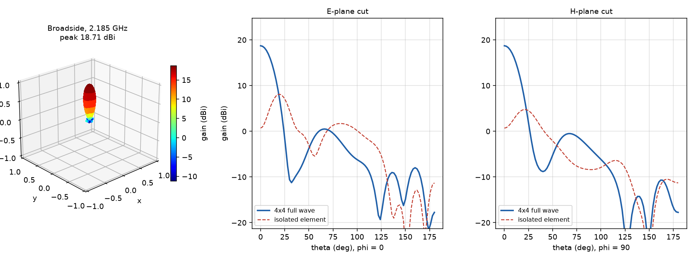
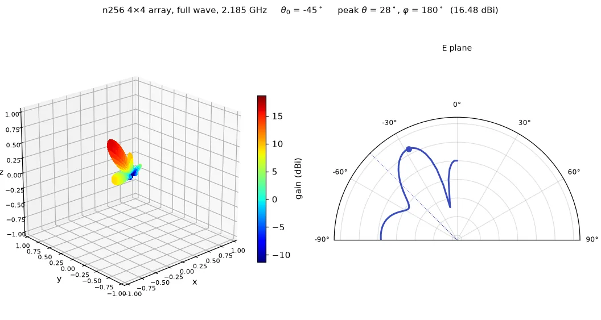
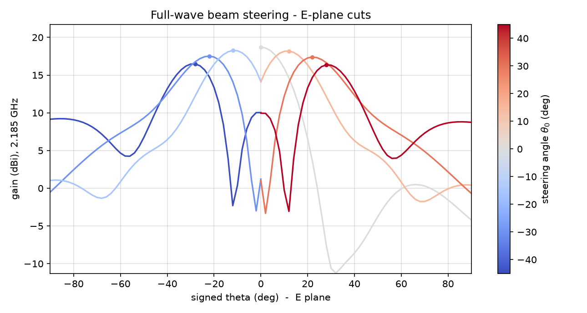
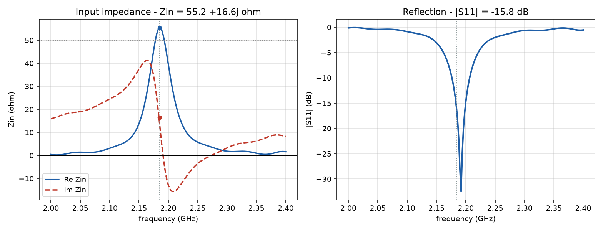
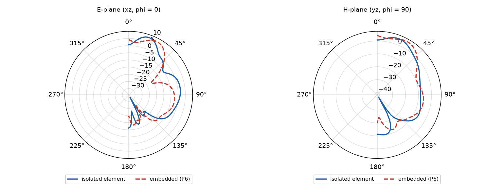
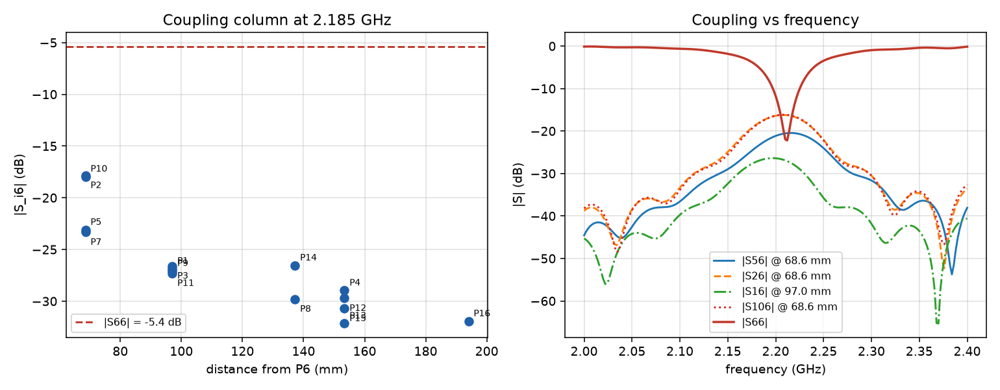

<h1 align="center">n256 4×4 Patch Array at 2.185 GHz</h1>

<p align="center">
  <em>Full-wave follow-up of the sizing study: element tuning, embedded
  element and broadside array in openEMS</em>
</p>

<p align="center">
  
  
  
</p>

---

## Overview

The sizing study (`automotive-ntn-ue-sizing`) predicted a 33 cm module and
about 17 dBi for a 4×4 array at n256.  This project checks that with full-wave
FDTD: one board, three excitations – isolated element, embedded element (only
P6 driven) and the fully driven broadside array.

| | |
|---|---|
| Centre frequency | 2.185 GHz (n256 Rx 2170–2200 MHz) |
| Substrate | RO4003C, εr 3.55, tan δ 0.0027, h 1.524 mm |
| Patch | **33.0 × 45.5 mm**, probe inset **9.9 mm** |
| Lattice / board | 68.6 mm (λ₀/2) / 340 mm |
| Mesh | max 8 mm, refined 2.5 mm, min 1.5 mm, min z 0.40 mm |

## Results

| Quantity | Value |
|---|---|
| Element Zin (2.185 GHz) | 55.2 + 16.6j Ω |
| Element \|S11\| | **−15.8 dB** (best −32.5 dB at 2.192 GHz) |
| Element VSWR | 1.39 |
| −10 dB bandwidth | 2.178–2.206 GHz (28 MHz) |
| Element directivity / gain | 9.86 / 8.77 dBi, η 0.779 |
| Embedded element | 9.62 dBi, η 0.711 |
| Self reflection (embedded) | −5.4 dB |
| Neighbour coupling (λ/2) | −17.8 dB |
| **Array directivity** | **18.71 dBi** |
| **Array gain (corrected)** | **18.10 dBi**, η 0.869 |

<p align="center">
  
</p>

## Beam steering

Six additional FDTD runs steer the beam with a progressive port phase
(90° per element gives 30°); the 0° frame reuses the broadside run.  The
animation is available as animated **WebP** (inline below), **GIF** and **MP4**.

<p align="center">
  
</p>

| nominal θ₀ | peak θ | peak φ | gain |
|---|---|---|---|
| −45° | 28° | 180° | 16.48 dBi |
| −30° | 22° | 180° | 17.52 dBi |
| −15° | 12° | 180° | 18.26 dBi |
| 0° | 0° | – | 18.71 dBi |
| +15° | 12° | 0° | 18.19 dBi |
| +30° | 22° | 0° | 17.39 dBi |
| +45° | 28° | 0° | 16.36 dBi |

<p align="center">
  
</p>

The beam follows the nominal angle but lags increasingly (3° at ±15°, 8° at
±30°, 17° at ±45°): the element pattern falls off towards the horizon and pulls
the product maximum back towards broadside.  The peak gain drops from 18.71 dBi
(broadside) to 16.36 dBi at +45°, i.e. about 2.3 dB of scan loss – consistent
with the 3–4 dB assumed in the sizing study.

| File | Format |
|---|---|
| [`anim_beam_steer.webp`](docs/figures/anim_beam_steer.webp) | animated WebP, inline on GitHub |
| [`anim_beam_steer.gif`](docs/figures/anim_beam_steer.gif) | GIF, universal fallback |
| [`anim_beam_steer.mp4`](docs/figures/anim_beam_steer.mp4) | H.264, for download |

## What the full-wave run added to the sizing study

1. **The Hammerstad length is only a start.** With the inset present the
   input resistance follows R_in = R_edge·cos²(πs/L) while the resonant
   product f·L stays constant at ≈ 72 GHz·mm.  Tuning from 36.0 mm / 1.8 mm to
   33.0 mm / 9.9 mm moved the match from −0.8 dB to −15.8 dB.
2. **The isolated element beam is tilted** by about 26° because the deep
   inset probe breaks the symmetry on the finite 340 mm ground plane.  In the
   fully driven array the symmetric excitation restores a clean broadside
   beam.
3. **The element is too narrowband for the coupled environment.**  Mutual
   coupling shifts the element resonance from 2.192 GHz to ≈ 2.205 GHz –
   more than half of the 28 MHz matching bandwidth – so the embedded element
   sees only −5.4 dB.  This is the main design lesson: a 1.5 mm substrate is
   too thin for a λ/2 array at n256; a thicker substrate or a broadband
   (stacked) element is needed.
4. **The array itself performs as predicted and better:** 18.71 dBi
   directivity (aperture estimate 17 dBi) and 18.10 dBi realised gain at
   η = 0.87.

<p align="center">
  
</p>

<p align="center">
  
</p>

<p align="center">
  
</p>

## Repository layout

```
array_model.py      geometry, mesh, project factory (single source of truth)
make_project.py     writes the three .fcsim.json projects
validate_project.py pre-run mesh/collision checks
run_headless.py     openEMS runner (VisualopenEMS headless)
plot_results.py     S-parameters + NF2FF -> figures and docs/results.json
make_sweep.py       writes the seven beam-steering projects
run_sweep.py        runs the sweep, archives docs/sweep/*.npz
make_animation.py   builds GIF / WebP / MP4 + figure 06
build_docs.py       English and German ODT reports (+ PDF)
run_all.py          end-to-end runner with skip logic
docs/figures/       figures 01..06 + anim_beam_steer.{webp,gif,mp4}
docs/sweep/         archived 2.185 GHz patterns of the steering sweep
docs/results.json   every number used in the report
docs/n256_array_2p185ghz_en.odt/.pdf   report, English (primary)
docs/n256_array_2p185ghz_de.odt/.pdf   report, German (secondary)
```

## Reproduction

```powershell
python make_project.py
python validate_project.py
python run_headless.py patch_element_2p2ghz.fcsim.json
python run_headless.py array_4x4_2p2ghz.fcsim.json
python run_headless.py array_4x4_broadside_2p2ghz.fcsim.json
python make_sweep.py
python run_sweep.py
python plot_results.py
python make_animation.py
python build_docs.py
```

Runtime: the element runs take about 19 min (24k timesteps, 1.0 M cells), the
array runs about 35–40 min each on an 8-core laptop.

## Limitations / next steps

* Probe feed is a modelling abstraction for independent element excitation; a
  product would use a corporate microstrip feed (≈1–1.5 dB loss).
* Circular polarisation and the ±60° scan sweep are not simulated yet.
* The element bandwidth (28 MHz) covers only the upper part of the 30 MHz
  channel; L = 33.2 mm would centre it.  A thicker substrate (3.0 mm) is the
  more robust fix.
* A finite-roof ground plane (1.4 × 1.2 m) should be added to quantify the
  vehicle-body effect.

---

## Kurzfassung (Deutsch)

Vollwellen-Fortsetzung der Sizing-Studie für **n256** (2170–2200 MHz) auf
RO4003C (1,524 mm): ein 4×4-Array auf 340 mm Platine, 68,6 mm Raster.

**Element:** L = 33,0 mm, Inset 9,9 mm → Zin = 55,2 + 16,6j Ω, **|S11| =
−15,8 dB** (bestes −32,5 dB bei 2,192 GHz), −10-dB-Band 2,178–2,206 GHz,
Richtfaktor 9,86 dBi, η 0,78.  Die Hammerstad-Länge (36,0 mm) ist nur ein
Startwert: Mit Inset gilt R_in = R_edge·cos²(πs/L), das Produkt f·L bleibt
konstant.

**Eingebettetes Element:** Die Kopplung verschiebt die Resonanz von 2,192 auf
ca. 2,205 GHz – mehr als die halbe Anpassbandbreite – daher nur **−5,4 dB**
Eigenreflexion; Nachbarkooplung **−17,8 dB**.  Wichtigste Designlehre: 1,5 mm
Substrat ist für ein λ/2-Array bei n256 zu dünn.

**Broadside-Array:** **18,71 dBi** Richtfaktor, **18,10 dBi** realisierter
Gewinn bei η = 0,869 – besser als die Aperturschätzung der Sizing-Studie
(17 dBi).

Berichte: `docs/n256_array_2p185ghz_en.odt` (Englisch, Hauptsprache) und
`docs/n256_array_2p185ghz_de.odt` (Deutsch), jeweils mit PDF.
